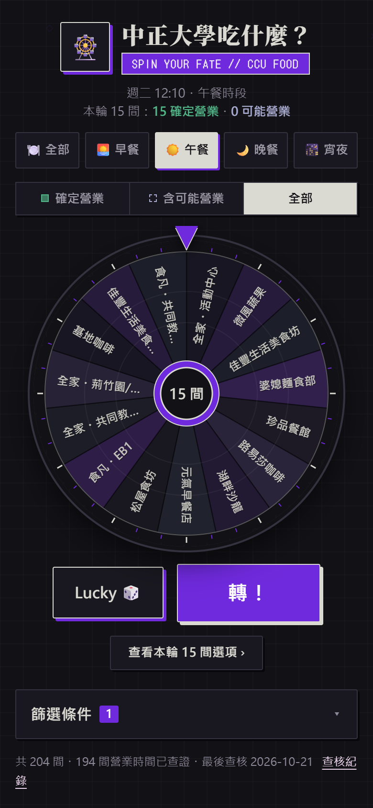
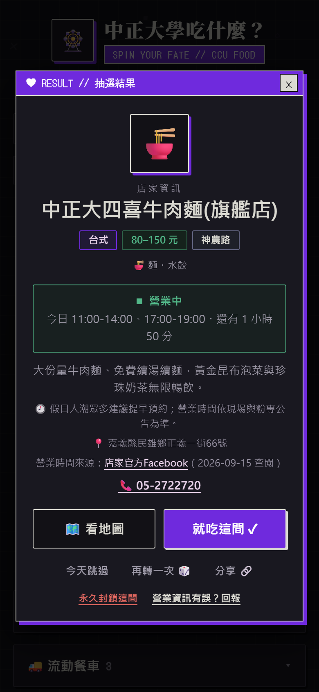
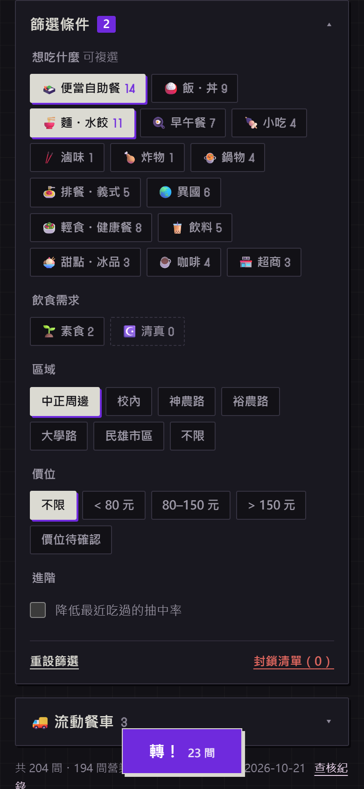
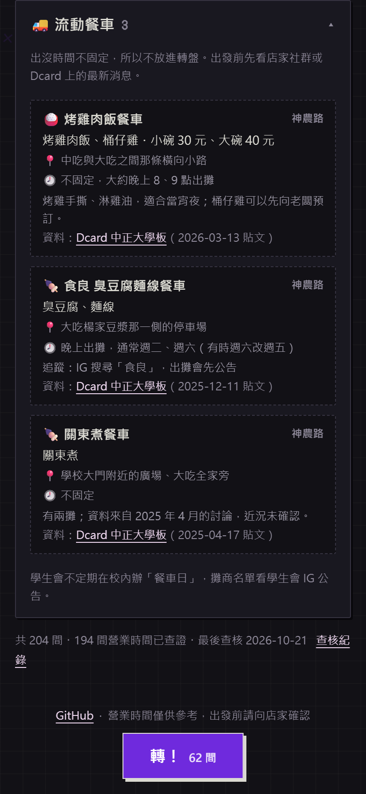
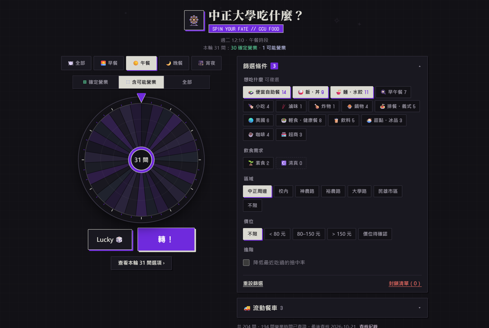
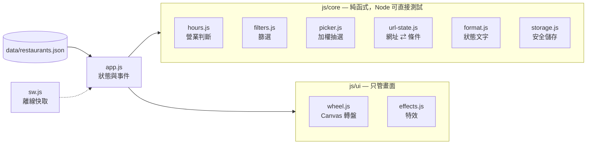

# 🎡 中正大學吃什麼？ — CCU Food Roulette

[](https://github.com/CharlieChiu39/Don-t-know-what-to-eat-/actions/workflows/ci.yml)

**[▶ 線上試用](https://charliechiu39.github.io/Don-t-know-what-to-eat-/)**　·　ZUTOMAYO × ZUTOMAYO MART 霧面復古視窗風格的中正大學選餐轉盤

收錄中正大學周邊 **92 間**（校內、神農路、裕農路、大學路）與民雄市區 **112 間**餐廳，另外列出附近的流動餐車。用台北時間即時判斷哪些店「現在」真的有開，並標示資料可信度。可以依「想吃什麼」篩選，也能裝到手機桌面，沒有網路時照樣能用。

| 手機首頁 | 抽選結果 | 篩選 | 流動餐車 |
| :---: | :---: | :---: | :---: |
|  |  |  |  |



---

## 解決什麼問題

中正大學離市區遠，選擇有限，「今天吃什麼」每天都要想。Google 地圖跟外送平台的營業時間又常常過期，走到店門口才發現沒開是最常見的踩雷。

所以這個專案的重點不是轉盤本身，而是**轉出來的店現在走過去能不能吃到**：

- **營業狀態分三層**：服務公告（例如校內停水停電）優先，其次是有來源的時刻表與單日調整（臨時店休），最後才用未查證的舊資料推估，並清楚標成「可能營業」。
- **快打烊的店不放進轉盤**：剩不到 15 分鐘就不列入候選，30 分鐘內會提示「即將打烊」，休息中的店則顯示下次開門時間（例如「明天 11:00」）。
- **可信度透明**：結果卡附上營業時間的來源連結與查閱日期，未查證的店直接寫明。204 間中有 194 間有來源：校方與店家頁面優先，沒有的才用 Google 地圖商家資訊，並在卡片上標明。[查核紀錄](docs/restaurant-audit.md)逐店記錄。

## 功能

| | |
| --- | --- |
| 🕐 即時營業狀態 | 支援跨夜營業（18:00–02:00）、24 小時、分段時段、單日臨時店休、服務公告；每分鐘自動更新 |
| ❄ 寒暑假與國定假日 | 依校方行事曆判斷：寒暑假暫停的校內店顯示「寒假暫停營業・預計 2/22 起恢復」，時段另行公告的店標成「請先確認」 |
| 🚦 三段營業篩選 | 「確定營業／含可能營業／全部」。舊資料推估的「可能營業」用虛線與獨立色調，並顯示推估剩餘時間 |
| 🍜 想吃什麼 | 17 個標籤（便當、麵、滷味、早午餐…），可複選；每個標籤旁即時顯示「選了會有幾間」 |
| 📍 區域 | 預設只抽「中正周邊」；想進市區再選「民雄市區」或「不限」。周邊都沒開時，一鍵放寬會提議擴大到市區 |
| 🚚 流動餐車 | 從 Dcard 中正板整理出常出現的餐車：位置、出攤規律、追蹤方式與原文連結。時間不固定，所以不放進轉盤 |
| 🌅 依時段自動選餐別 | 早上開就是早餐、晚上 9 點後是宵夜；條件太嚴時提供「一鍵放寬」並說明會放寬什麼 |
| 🔁 抽完之後 | 「今天跳過」隔天自動恢復，「永久封鎖」另外放，兩者都能一鍵復原；再轉一次不會抽回剛否決的店，第二次起動畫縮短、點一下可略過；「就吃這間」後結果卡留著方便分享 |
| 📞 結果卡 | 電話一按撥號、營業提醒（例如週六隔週休）、資料來源與查閱日；資訊有誤可直接回報 |
| ⚖️ 降低最近吃過的機率（可選） | 預設關閉。開啟後最近吃過的店抽中機率較低，轉盤上的扇形也會跟著變窄 |
| 🔗 分享 | 網址會帶上篩選條件與抽選結果，傳給朋友就是同一個畫面；支援 Web Share API |
| 📱 PWA | 可加到主畫面；第一次載入後，離線也能開啟與轉動 |
| ♿ 無障礙 | 原生 `<dialog>`、完整鍵盤操作、讀屏播報結果、`prefers-reduced-motion`、WCAG AA 對比 |

## 技術重點

### 零執行期依賴、零建置步驟

網站本身是原生 ES Modules 加上原生 CSS（cascade layers、`:has()`、`color-mix()`），沒有框架、打包工具或 CDN 執行期依賴。直接把 repo 根目錄部署到 GitHub Pages 就行。

開發工具（TypeScript、Playwright、axe）只在 `devDependencies`，不會出現在使用者的瀏覽器裡。

### 不需要編譯的型別安全

所有 JS 都用 JSDoc 標型別，由 `tsc --checkJs --strict` 檢查。共用型別集中在 [`js/types.d.ts`](js/types.d.ts)，service worker 另外用 `tsconfig.sw.json` 搭配 WebWorker lib 檢查。

### 架構：純函式核心、薄 UI 層



所有商業邏輯都在 `js/core/`，不碰 DOM、時間可注入，所以單元測試不需要瀏覽器。`app.js` 只負責把狀態畫到畫面上。

### 測試

| 層級 | 工具 | 內容 |
| --- | --- | --- |
| 單元測試 | `node:test`（42 項） | 營業判斷邊界（開始包含、結束排除、跨夜、未知日）、寒暑假與國定假日、篩選（飲食需求與想吃什麼同時成立）、加權抽選的分佈、網址解析容錯（含舊版連結）、儲存失敗降級 |
| 資料檢查 | `node:test` | ID 唯一、列舉值合法、所有時刻表可解析、已查證必附 https 來源、市區店家必附地圖頁、餐車欄位合法。新增餐廳時由 CI 把關 |
| E2E | Playwright（28 情境 × 手機／桌面） | 抽選流程、分享連結、區域切換、餐車面板、封鎖與恢復、一鍵放寬、鍵盤操作、**離線可用**、無 console 錯誤；寒假顯示、今天跳過與復原、再轉不重複、略過動畫、小螢幕第一屏 |
| 無障礙 | axe-core | 主畫面、結果對話框與餐車面板 0 違規 |

E2E 用 `page.clock.setFixedTime` 把時間固定在學期中的週二中午（寒假情境固定在 2027-01-26），營業狀態每次都一樣，不會因為跑測試的時間不同而失敗。

### 使用者實測

請 4 位模擬使用者（趕課的大一新生、宵夜常客、一起決定晚餐的三個室友、寒假留校的研究生）在手機尺寸、真實 Chrome 上完成各自的任務，依回報修正：

| 發現的問題 | 修正 |
| --- | --- |
| 寒假時校內店照樣顯示「營業中」 | 加入校方行事曆（`data/calendar.json`），寒暑假與國定假日依校方公告標示 |
| 只核對地址的店被算成「營業時間已查證」 | 改以 `openHours` 是否有來源判斷，結果卡分開寫「店家資訊來源」 |
| 「可能營業」和「確定快打烊」看起來一樣 | 推估狀態改用虛線與獨立色調，並顯示推估剩餘時間 |
| 「不想吃這間」直接永久封鎖 | 分成「今天跳過」與「永久封鎖」，都能復原 |
| 再轉一次會抽回剛否決的店，每次等 5 秒 | 否決的店本輪排除；第二次起約 2 秒，可點一下略過 |
| 素食＋麵被當成「或」，混進牛肉麵 | 飲食需求與想吃什麼改為同時成立 |
| 小手機第一屏看不到「轉！」 | 標題列改單行、轉盤隨螢幕高度縮放；捲到下面時浮出「轉！」 |
| 三間全家在轉盤上分不出來 | 連鎖店保留分店名（全家・活動中心） |

### 效能

Lighthouse（行動裝置模擬、本機未壓縮），同一套視覺設計改版前後：

| | 改版前 | 改版後 |
| --- | :---: | :---: |
| Performance | 58 | **92** |
| Accessibility | 91 | **100** |
| Best Practices / SEO | 100 / 100 | **100 / 100** |
| First Contentful Paint | 7.8 s | **2.3 s** |
| Total Blocking Time / CLS | 0 ms / 0.005 | **0 ms / 0.002** |

主要做了這幾件事：

- 移除 Tailwind Play CDN（執行期才編譯 CSS）
- 內文改用系統字型。Noto Sans TC 的 Google Fonts 樣式表含數百個 `unicode-range` 區塊（Lighthouse 判定約 135 KiB 未使用），而且會擋住首次繪製
- 標題的 Noto Serif TC 與像素字 DotGothic16 用 `text=` 參數只載入畫面上實際出現的字，並且非同步載入
- 用 `modulepreload` 攤平 ES module 的瀑布式載入
- 預先保留由 JS 產生的元素高度，避免版面位移
- 轉盤用 `ResizeObserver` 搭配 `devicePixelRatio` 繪製，Retina 螢幕不會糊，初始化也不會強制同步排版

程式碼加資料（HTML、JS、CSS、JSON）gzip 後約 57 KB，其中 204 間餐廳的資料約 23 KB。

## 設計決策與取捨

- **為什麼不用 React／Vue？** 這是一個單頁、資料約 200 筆的工具，互動集中在一個轉盤和幾組篩選。用框架帶來的建置流程和 bundle 成本，換不到對等的好處；把邏輯拆成可測試的純函式模組，才是真正降低複雜度的地方。
- **台北時間固定用 UTC+8，不依賴 `Intl` 或使用者時區。** 台灣沒有夏令時間，這樣算最簡單、可以預測，而且出國交換的學生打開網頁也會看到正確的營業狀態。
- **資料不明時寧可說「不知道」。** 前一天的時段未知時，就無法排除跨夜營業，所以不判定為休息。舊資料只能推估成「可能營業」，標示和顏色都跟已查證的分開。
- **Service worker 採 network-first（3 秒逾時才改用快取）。** 部署後使用者馬上拿到新版；只有校園網路不穩時才退回快取。
- **「降低最近吃過」預設關閉。** 改變抽選機率屬於使用者的選擇，不該偷偷替人決定。
- **預設只抽中正周邊。** 市區的店要騎車十分鐘以上，抽到了也不一定會去；所以市區要自己選，或在周邊都沒開時由「一鍵放寬」提議。
- **Google 地圖時段可以用，但要標明。** 校方與店家頁面優先；只有它們沒寫每週時段時才採用 Google 地圖商家資訊，結果卡寫出來源並連到商家頁。外送平台的時段只代表外送服務時間，不採用。
- **餐車不放進轉盤。** 餐車沒有固定時刻表，放進轉盤只會抽到不在的攤子，所以只列出位置、規律和追蹤方式。
- **資料存在 JSON，而不是 JS 全域變數。** 方便用腳本和測試檢查，也能被 service worker 快取。

## 開發

需要 Node.js 22 以上。

```sh
npm install
npm run dev          # http://localhost:5173
npm test             # 單元測試與資料檢查
npm run typecheck    # tsc 檢查 JSDoc 型別
npm run test:e2e     # Playwright（本機使用已安裝的 Chrome）
npm run check        # 以上全部
node scripts/screenshots.mjs   # 重新產生 README 截圖與 og-image（需先 npm run dev）
```

```
├── index.html
├── css/app.css            # 原生 CSS，cascade layers
├── data/restaurants.json  # 204 間餐廳與查證資訊
├── data/trucks.json       # 流動餐車
├── js/
│   ├── app.js             # 進入點：狀態、事件、渲染
│   ├── types.d.ts         # 共用型別
│   ├── core/              # 純函式（營業判斷、篩選、抽選、網址、儲存）
│   └── ui/                # Canvas 轉盤、特效
├── sw.js                  # 離線快取
├── tests/                 # node:test 單元與資料檢查
├── e2e/                   # Playwright 端對端測試
├── scripts/               # 開發伺服器、截圖
└── docs/                  # 查核紀錄、研究筆記、截圖
```

### 新增或修改餐廳

編輯 `data/restaurants.json`，欄位定義在 [`js/types.d.ts`](js/types.d.ts)，標籤清單在 [`js/core/catalog.js`](js/core/catalog.js)。

有查證來源的營業時間放 `openHours`，並在 `verification` 附上 https 來源與查閱日期；沒有來源的時間放 `legacyOpenHours`。餐車放 `data/trucks.json`。改完執行 `npm test`，資料檢查會擋下格式錯誤。

## 已知限制

- 10 間店連 Google 地圖都沒有列出時段，只能顯示「時間未知」或用舊資料推估。
- Google 地圖的時段由店家或使用者維護，可能比現況舊；臨時店休仍以店家公告為準。
- 寒暑假與國定假日時段還沒有接上校曆，這段期間請以店家公告為準。
- `experiments/room.js` 是早期的多人房間草稿，頁面沒有載入。

## 授權與資料

程式碼由 CharlieChiu39 開發。餐廳資料來自中正大學飲食資訊、各店家的公開頁面與 Google 地圖商家資訊，餐車資料來自 Dcard 中正大學板。查閱日期不等於店家更新日期，出發前請以店家公告為準。
